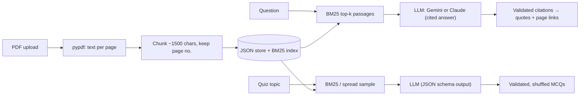

# StudyLens

**Ask your lecture notes questions and get answers that cite the exact page. Then quiz yourself on them.**

StudyLens is a study assistant built on retrieval-augmented generation (RAG). Upload course PDFs (slides, notes, readings) and:

- **Ask**: get answers grounded in *your* materials, with inline citations. Click a citation to see the quoted passage, or open the PDF at that page.
- **Quiz me**: generate multiple-choice questions on any topic from your materials, at three difficulty levels. Each question links back to the page it tests.

> _Screenshot / GIF goes here._

## Why it's built this way

| Decision | Why |
|---|---|
| **Page-level chunks** | Every passage keeps the file and page it came from, so citations point somewhere a student can check. |
| **Swappable model provider** | One setting switches between **Gemini** (free tier) and **Claude**. Both sit behind the same two-function interface in [`app/llm/`](backend/app/llm/), so the rest of the app doesn't know which model it's talking to. |
| **Citations that can't point at nothing** | With Claude, each passage is a `document` block with the native citations API, which returns the exact quoted text. With Gemini, passages are tagged `S1`, `S2`… and the model cites them inline. The markers are parsed and checked against what was actually retrieved, so an invented id is dropped and the quote shown is the best-matching sentence from the real passage. |
| **Model fallback for the free tier** | Free Gemini models are often overloaded (503), rate-limited (429) or very slow. Each request gets a 20 s budget per model, then falls through a list of models (`gemini-3.8-flash` → `gemini-3.6-flash` → `gemini-3.5-flash-lite`). In testing this turned a 3-minute hang into an answer in under 35 s. |
| **BM25 retrieval, written from scratch** | Course questions reuse the lecture's own terms, so keyword search is a strong, transparent baseline with no embedding model to host. It's ~50 lines in [`retrieval.py`](backend/app/retrieval.py). |
| **Structured outputs for quizzes** | Quiz generation uses a JSON schema, so the UI never has to parse free text. Malformed items are dropped and answer positions are shuffled server-side to remove position bias. |
| **"Not in your notes" is an allowed answer** | The prompt tells the model to say when the excerpts don't cover a question instead of answering from general knowledge. |

## Architecture



**Stack:** Python · FastAPI · Google Gen AI SDK (Gemini) / Anthropic SDK (Claude) · pypdf · React 18 · TypeScript · Vite

```
backend/app/
  main.py        FastAPI routes, upload validation, error mapping
  ingest.py      PDF → per-page text → overlapping chunks
  retrieval.py   BM25 implementation
  store.py       documents/chunks persistence + search
  llm/
    __init__.py  picks the provider from LLM_PROVIDER
    common.py    shared prompts, quiz schema/validation, citation parsing
    gemini.py    Gemini: [S#] citation markers + JSON schema quizzes
    claude.py    Claude: native citations API + structured outputs
frontend/src/
  components/    Library (uploads), AskView (chat + citations), QuizView
```

## Run it locally

You need Python 3.11+, Node 18+, and an API key for one provider:

| Provider | Cost | Key |
|---|---|---|
| **Gemini** (default) | Free tier with rate limits. On the free tier Google may use your prompts to improve its products. | [Google AI Studio](https://aistudio.google.com/apikey) → `GEMINI_API_KEY` |
| **Claude** | Pay-as-you-go | [Claude Platform](https://platform.claude.com/) → `ANTHROPIC_API_KEY`, and set `LLM_PROVIDER=claude` |

```bash
# 1. Backend
cd backend
python -m venv .venv
.venv\Scripts\activate            # macOS/Linux: source .venv/bin/activate
pip install -r requirements.txt
cp .env.example .env              # then add your key (GEMINI_API_KEY or ANTHROPIC_API_KEY)
uvicorn app.main:app --reload     # http://localhost:8000

# 2. Frontend (new terminal)
cd frontend
npm install
npm run dev                       # http://localhost:5173
```

For a single-server setup, run `npm run build` in `frontend/`. FastAPI then serves the built app at http://localhost:8000.

After changing how PDFs are parsed or chunked, rebuild the passages of already-uploaded files with `python -m app.reindex` (in `backend/`, with the server stopped).

## Roadmap

- [ ] **Retrieval eval**: a labeled set of questions → expected pages, measuring recall@k and citation accuracy, and comparing Gemini vs Claude on the same set
- [ ] **Hybrid retrieval**: add embeddings + reciprocal rank fusion, and show the improvement over BM25 using the eval
- [ ] **Weak-topic tracking**: record quiz results per topic and suggest what to review
- [ ] **Follow-up questions**: multi-turn conversations
- [ ] **OCR** for scanned PDFs
- [ ] **Deploy** a public demo
